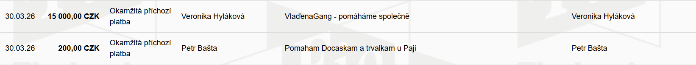

# E-shop VladěnaGang: přísliby pomoci a provozní vazby

**Šanon VI · Vydřin archiv Oddělení klidu**

**Stav:** Zpracované archivní podklady; úplný výpočet a tok příspěvků neověřen

**Verze:** 1.3 · 27. listopadu 2026

Jakou část nákupu e-shop sliboval věnovat na pomoc a kdo se podílel na jeho provozu? Porovnali jsme konkrétní archivní stránky. Rozdíl mezi částečným a celým příspěvkem není jen otázkou dvou dat: obě formulace jsou zachyceny současně na jedné stránce.

## Část, nebo celá částka z prodeje?

Archivní [stránka charitativní kategorie z 10. srpna 2026](https://web.archive.org/web/20260810082919/https://www.vladenagang.cz/kup-si-radost-posli-dobro/) obsahuje dvě formulace:

| Místo v popisu kategorie | Krátký výpis |
| --- | --- |
| Úvodní popis příspěvku | „ze kterých část putuje na dobrou věc“ |
| Následující vysvětlení podpory | „celá částka z prodeje“ |

**Interpretace:** Rozdílná vymezení mohou zákazníkovi znesnadnit určení, jaký příspěvek nákupem poskytuje. Nejde o doloženou změnu slibu v čase; oba texty jsou v témže zachycení. Stránka se vztahuje ke konkrétní kategorii, která tehdy zobrazovala dvě klíčenky, nikoli automaticky ke všem tržbám e-shopu. Detailní pravidla jednotlivých produktů jsme tímto neověřili.

Nález sám neukazuje, kolik kusů se prodalo a jaké částky skutečně obdrželi příjemci. Nevydáváme ho za důkaz zneužití peněz nebo rozhodnutí o porušení zákona.

## Kdo byl uveden při provozu e-shopu

[Podmínky ochrany osobních údajů zachycené 25. září 2026](https://web.archive.org/web/20260925105200/https://www.vladenagang.cz/podminky-ochrany-osobnich-udaju/) uvádějí **Petra Baštu, IČO 74284215**. Jmenují také **Veroniku Hylákovou** při externím balení a odesílání objednávek a popisují práci podle Baštových pokynů.

Jde o konkrétní provozní roli uváděnou webem. Samotný text neprokazuje správu bankovního účtu, vlastnictví e-shopu ani skutečný rozsah prováděné práce. V [zachycení stejné stránky z 10. srpna](https://web.archive.org/web/20260810082919/https://www.vladenagang.cz/podminky-ochrany-osobnich-udaju/) tato pasáž chybí. Přesný den jejího vložení ani začátku spolupráce neznáme.

Související [Šanon VIII](../P%C5%99%C3%ADpad%20Veronika%20Hyl%C3%A1kov%C3%A1/index.html) nově uvádí tento přímý archivní zdroj. Rejstříkový záznam stejnojmenné osoby zůstává samostatnou, nepropojenou stopou.

## Co máme ze dvou dat a co je rekonstrukce

Starší místní balíček obsahuje archivní podklady i upravené statické prezentace. Každé stránce proto přiřazujeme její skutečné archivní datum:

| Podoba nebo datum | Povaha podkladu |
| --- | --- |
| 10. srpna 2026 | Přímá archivní zachycení homepage, charitativní kategorie a dalších stránek |
| 6. září 2026 | Dochované archivní zachycení homepage |
| 18. září 2026 | Označená místní rekonstrukce; není přímým snapshotem z tohoto dne |
| 25. září 2026 | Tehdejší místní kopie a nově ověřená archivní zachycení včetně podmínek soukromí |

Ve [srpnové homepage](https://web.archive.org/web/20260810082905/https://www.vladenagang.cz/) byla prezentována nabídka a navigace e-shopu. [Zářijová homepage](https://web.archive.org/web/20260925105144/https://www.vladenagang.cz/) je výrazně prázdnější, zatímco některé informační stránky zůstaly zachovány. To samo neurčuje příčinu omezení ani právní či faktický konec podnikání. Chybějící obsahový snímek dřívějšího období není důkazem, že web tehdy neexistoval.

## Uložené podoby k prohlížení a stažení

- [Otevřít rozcestník obou uložených podob](offline/index.html)
- [Stáhnout obě podoby jako ZIP pro prohlížení bez připojení](prilohy/eshop-offline-dve-varianty.zip)

Balíček obsahuje **rekonstrukci homepage z 10. srpna 2026** a **statickou kopii dvanácti stránek z 25. září 2026**. Nejde o dva úplné technické otisky obchodu. Srpnové odkazy do dalších sekcí vedou do internetového archivu; tyto sekce nejsou uloženy v balíčku. Zářijové informační stránky lze procházet místně. Po rozbalení otevřete hlavní soubor `index.html`.

Kopie mají viditelné označení původu a data. Skripty byly odstraněny a formuláře i nákupní prvky jsou neaktivní. Obsahují historické veřejné texty a kontakty e-shopu; samotné kopie nepotvrzují současnou platnost uvedených údajů. Podrobnosti úprav uvádí rozcestník.

## Transparentní účet: dvě zachycené platby z 30. března 2026

[Otevřít transparentní účet Fio banky, účet 2803068745 (období 23. 9. 2025 až 23. 9. 2026)](https://ib.fio.cz/ib/transparent?a=2803068745&f=23.09.2025&t=23.09.2026)

Níže je **výřez ze snímku výpisu dodaného Oddělení klidu**. Záměrně zachovává jen dva relevantní řádky z 30. března 2026, aby nezveřejňoval údaje dalších přispěvatelů. Výřez není úplným bankovním výpisem. Přímý odkaz na účet je veřejný, ale jeho aktuální obsah a historické transakce nebyly pro tuto aktualizaci nezávisle znovu načteny.

*Zdroj: snímek veřejného transparentního účtu poskytnutý Oddělení klidu; výřez bez ostatních transakcí. Částky a texty níže jsou přepisem toho, co je na obrázku vidět.*

| Datum | Částka | Jméno zobrazené na výpisu | Poznámka uvedená u platby |
| --- | ---: | --- | --- |
| 30. 3. 2026 | 15 000 Kč | Veronika Hyláková | „VladěnaGang - pomáháme společně“ |
| 30. 3. 2026 | 200 Kč | Petr Bašta | „Pomaham Docaskam a trvalkam u Paji“ |

**Co snímek dokládá:** V zachyceném výpisu jsou oba uvedené příchozí záznamy se stejným datem a odlišnými jmény i poznámkami. Samotný popis platby není účetním dokladem o zdroji peněz. Z těchto dvou položek nelze vypočítat celkový objem pomoci, doložit původ v tržbách e-shopu ani vyloučit jiné příspěvky. Údaj o 200 Kč proto **není údajem o celkové pomoci**.

Související [veřejná reakce Idealisty (od 3:43)](https://www.youtube.com/watch?v=s3v2gQLzj2Q&t=223) zobrazuje výřezy těchto plateb a potvrzení. Jeho výklad původu peněz je nutné odlišit od toho, co skutečně zachycuje samotný výpis.

> **Hamburgerova poznámka (satirický komentář):** „Dvě stovky, patnáct tisíc a internetová bitva o jeden výpis! Čísla tu jsou. Ale kolik z toho bylo z prodejů? Bez vyúčtování budeme jen přehazovat částky jak hranolky na pánvi.“

## Jak se prostředky dostaly k Veronice Hylákové?

**V dostupných podkladech není doloženo, zda platba 15 000 Kč vedená pod jménem Veroniky Hylákové pocházela z výdělku e-shopu, z jejích vlastních prostředků, nebo z kombinace zdrojů.** Idealistův výklad původu peněz v [reakci od 3:43](https://www.youtube.com/watch?v=s3v2gQLzj2Q&t=223) nepovažujeme za nezávislé doložení této vazby. Předložené výřezy plateb a potvrzení dokládají zachycené převody; samy nepropojují konkrétní prodeje, výpočet příspěvku a cestu peněz k odesílatelce.

Pokud mělo jít o prostředky z podnikání Petra Bašty, potřebujeme vysvětlit a doložit:

- Z jakých prodejů a za jaké období částka vznikla a zda se příspěvek počítal z tržeb, výtěžku, nebo zisku?
- Jakým způsobem se prostředky dostaly k Hylákové: převodem, v hotovosti, nebo jiným způsobem? Kdo jí je svěřil a na základě jaké dohody či pověření?
- Kdo schválil jejich odeslání příjemci a jak byla částka i případné předání Hylákové zaznamenána v účetnictví nebo daňové evidenci provozovatele?
- Jednala Hyláková při převodu za provozovatele, nebo poskytovala vlastní dar? Jak toto rozlišení dokládají navazující záznamy?
- Pokud při této činnosti přistupovala k neveřejným účetním údajům nebo nakládala s podnikatelskými prostředky, jaký byl rozsah a základ jejího pověření?

K ověření by pomohly navazující doklady s odstraněnými soukromými údaji, které propojí výpočet příspěvku, případné předání prostředků a konečnou platbu. **Neuzavíráme, že žádné pověření nebo vysvětlení neexistovalo; v dosud prověřených podkladech je nemáme doložené.** Jméno na příchozí platbě samo neprokazuje přístup k účetnictví ani dispoziční oprávnění k Baštovu účtu.

## Co uvádí ARES/RES o zaměstnancích provozovatele

Dodaný snímek ARES/RES uvádí u **Petra Bašty, IČO 74284215**, kategorii počtu pracovníků **„Bez zaměstnanců“**. Jde o stejné IČO, jaké uvádějí archivní podmínky e-shopu. Na snímku je aktualizace databáze **27. listopadu 2026** a poslední změna údajů subjektu **7. října 2025**. [Oficiální odpověď ARES/RES](https://ares.gov.cz/ekonomicke-subjekty-v-be/rest/ekonomicke-subjekty-res/74284215), načtená 27. listopadu 2026, potvrzuje jméno, IČO, datum aktualizace záznamu a kód kategorie `110`; slovní označení přebíráme z dodaného snímku. [Výpis použitých polí a původ](prilohy/ares-res-74284215.json).

**Jde o evidovaný statistický údaj, nikoli o samostatné ověření pracovního vztahu Hylákové k 30. březnu 2026.** Data změny záznamu a aktualizace databáze sama neurčují období platnosti každého jednotlivého pole. Zářijová zmínka o externím balení objednávek nevysvětluje její březnovou roli při převodu peněz. Ani údaj „Bez zaměstnanců“ sám neurčuje, zda existovala jiná dohoda nebo pověření; jejich existenci a rozsah jsme neověřili.

## Co o podpoře zaznělo ve videích

- VLADĚNAplus podle dochovaných podkladů uvádí **100 % výtěžku vybraných produktů** a následně popisuje přidávání prostředků z dalších zdrojů. [Od 9:13](https://www.youtube.com/watch?v=NRQ3Hg27LXQ&t=553), [od 9:30](https://www.youtube.com/watch?v=NRQ3Hg27LXQ&t=570).
- Idealista předkládá výřezy plateb a uvádí **nejméně 75 000 Kč za první pololetí** plus materiální pomoc. [Výřezy od 3:43](https://www.youtube.com/watch?v=s3v2gQLzj2Q&t=223), [částka od 5:14](https://www.youtube.com/watch?v=s3v2gQLzj2Q&t=314).

Jde o veřejná vyjádření, nikoli zde provedenou úplnou účetní kontrolu. Tržby, výtěžek a zisk nezaměňujeme. Z jednotlivé platby ani její poznámky nelze samostatně určit původ všech peněz nebo podíl darů na celkovém prodeji. Procentní údaj o vybraných výrobcích nevyčísluje automaticky celý obchod.

## Co zůstává otevřené

- Jak byl příspěvek u jednotlivých výrobků přesně vypočten a vymezen zákazníkům?
- Upřesňovaly produktové detaily nejednotné znění kategorie?
- Jak se za stejné období oddělovaly příjmy z prodeje, náklady a další dary?
- Které platby odpovídaly kterým prodejům a příjemcům?

V dosud prověřených podkladech jsme nenašli úplný veřejný přehled umožňující tyto kroky zopakovat. Netvrdíme tím, že neexistuje nebo že žádná pomoc neproběhla. Pro tuto edici nemáme doložené konkrétní vyjádření provozovatele k souběžným formulacím kategorie. Bez evidence oslovení nepíšeme, že odmítl odpovědět.

## Podívejte se sami

- [Zdroje a význam podkladů](ZDROJE.md)
- [Metodika, ověření archivních otisků a omezení](METODIKA.md)
- [Časová osa](CASOVA-OSA.md)
- [Historie oprav](OPRAVY.md)
- [Výpis archivních záznamů a otisků](prilohy/archivni-zaznamy.json)
- [Přehled porovnání](prilohy/srovnani.csv)
- [Kontrolní součty edice](prilohy/SHA256SUMS.txt)

Podnět nebo opravu lze [přidat v repozitáři](https://github.com/oddeleniklidu/Sanony/issues). Nepřipojujte soukromé kontakty, celé bankovní výpisy ani údaje zákazníků. Opravy evidujeme s datem a důvodem.

[Zpět na přehled případů](../README.md)
